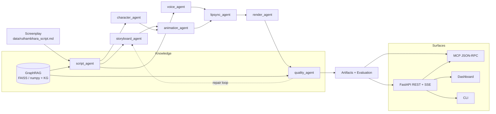

# RUTHAMBHARA — Agentic Film Studio

> An end-to-end **agentic AI film studio** for the Telugu feature *RUTHAMBHARA (ఋతంభర)*.
> Eight specialist agents run through a **LangGraph** DAG, retrieve from a **GraphRAG**
> screenplay index, synthesise voice, paint keyframes, assemble animatics, grade and
> gate quality — and expose all of it through a **FastAPI** API, an **MCP** tool gateway,
> real **evaluations** and a single-page **dashboard**.

Everything is **free and offline by default**: no API keys, no GPU, no Node build step.
Premium/local providers light up automatically when they are available.

---

## Table of contents

1. [What the MVP delivers](#what-the-mvp-delivers)
2. [Quickstart](#quickstart)
3. [Dashboard](#dashboard)
4. [Architecture](#architecture)
5. [The eight agents](#the-eight-agents)
6. [API reference](#api-reference)
7. [MCP gateway](#mcp-gateway)
8. [Free-first provider fallbacks](#free-first-provider-fallbacks)
9. [Configuration](#configuration)
10. [Testing](#testing)
11. [Docker](#docker)
12. [Project layout](#project-layout)

---

## What the MVP delivers

A single `python main.py run` (or one click on the dashboard) produces, for the
sampled scope of the film:

| Stage | Real output |
| --- | --- |
| **Screenplay intelligence** | Parsed 6 acts / 35 sequences / 98 shots / 17 cast / 3 music themes, emotion + lens distributions, coverage report |
| **Storyboard** | Shot design plus procedurally painted PNG keyframes and a contact sheet |
| **Character bible** | 17 character cards (deterministic faces), dialogue counts, emotion palettes, arc analysis |
| **Voice & subtitles** | Per-line WAV synthesis, dialogue reel, broadcast-ready `subtitles.srt`, casting sheet |
| **Animatic** | MP4 clips per shot (FFmpeg) plus an engine-agnostic free-video prompt pack |
| **A/V alignment** | Viseme/phoneme plans, synced clips, lip-sync confidence |
| **Render & delivery** | Edit decision list (`edl.csv`), reel assembly, colour pipeline, loudness plan, DCP/theatrical/social deliverables |
| **Quality gate** | Rubric per sequence (storyboard, voice, animation, lip-sync, emotion, music, coherence, consistency), bounded repair loop, pass/review decision |
| **Evaluation & MLOps** | Weighted LLM-rubric evaluation, JSONL history, LoRA/QLoRA fine-tune export |
| **Governance** | Script guardrails, tool-call guardrails, audit log, approval gate, Prometheus metrics, JSONL telemetry, traces |

---

## Quickstart

### 1. Install

```bash
# Python 3.11+ and FFmpeg are the only hard requirements.
python -m venv .venv
# Windows
.venv\Scripts\activate
# macOS / Linux
source .venv/bin/activate

pip install -e ".[rag,voice,dev]"
```

FFmpeg install: `winget install Gyan.FFmpeg` (Windows), `brew install ffmpeg` (macOS),
`sudo apt install ffmpeg` (Debian/Ubuntu). The pipeline degrades gracefully to a
manifest-only render if FFmpeg is absent.

### 2. Launch the studio

```bash
python main.py serve
# → dashboard  http://localhost:8080/dashboard
# → API docs   http://localhost:8080/docs
```

### 3. Run the MVP

```bash
python main.py mvp                 # sample scope, all media on (≈8 s on CPU)
python main.py run                 # sample scope, media per .env (on by default)
python main.py run --full          # plan the entire film
python main.py run --no-media      # plan only, no files rendered
python main.py run --json          # machine-readable result
```

### 4. Explore the screenplay

```bash
python main.py catalog
python main.py ask "What happens to Veera in Act 3?"
python main.py providers
python main.py evals --export
```

### 5. Use the MCP tools from any agent

```bash
python main.py mcp                 # JSON-RPC 2.0 over stdio
```

---

## Dashboard

`GET /dashboard` is a **self-contained** HTML/CSS/JS page served by the API — no build
step, no CDN, no external fonts. It reads live data from the API and streams run events
over SSE.

* **KPI strip** — acts, shots, quality mean, evaluation, artifacts, runs, runtime, elapsed
* **Production run** — the LangGraph DAG with per-agent status/duration, progress bar,
  `Run MVP` button and a live event stream
* **Overview** — film metadata, cast, themes, screenplay tree and latest-run artifacts
* **Storyboard** — contact sheet + every painted keyframe with shot metadata
* **Characters** — 17 portrait cards, dialogue/emotion stats, arc analysis
* **Voice & Subtitles** — per-line audio players, dialogue reel, SRT link
* **Animatic** — playable clips plus the free-video prompt pack
* **Render** — reel player, deliverables table, EDL, colour/audio plan
* **Quality** — rubric heat-table per sequence, issues and repair actions
* **Evaluations** — weighted rubric scores and one-click LoRA/QLoRA export
* **Ops & Governance** — providers, metrics, MCP tools, audit trail, approvals, traces
* **GraphRAG console** — ask questions in English or Telugu, get grounded answers with citations

The optional Next.js client in `web/` (`NEXT_PUBLIC_API_URL=http://localhost:8080`)
mirrors the same API and can be run with `npm install && npm run dev`.

---

## Architecture



* **LangGraph** `StateGraph` with a built-in superstep fallback when LangGraph is absent.
* **Fan-in with grouped edges** (`script → [storyboard, character, voice] → animation → …`)
  to avoid duplicate node execution.
* **Bounded repair loop**: the quality gate can send work back to storyboard/voice/animatic
  up to `AFP_MAX_REPAIR_LOOPS` times.
* **Agent Gateway** (`src/mcp_server.py`) exposes 12 tools to external agents.
* **Memory**: episodic/semantic/operational store with keyword recall.
* **Observability**: spans, counters/gauges/histograms, JSONL exporter, log buffer,
  Prometheus `/metrics`.

---

## The eight agents

| Agent | Responsibility | Key artifacts |
| --- | --- | --- |
| `script_agent` | Parse and analyse the screenplay (emotion, lens, dialogue distribution) | `coverage_report.md`, analysis JSON |
| `storyboard_agent` | Design frames + paint keyframes and a contact sheet | `frames/*.png`, `storyboard.json`, `contact_sheet.png` |
| `character_agent` | Build the character bible, deterministic portraits, face embeddings | `character_bible.json/.md`, `cards/*.png` |
| `voice_agent` | Multilingual TTS, casting sheet, SRT, dialogue reel | `audio/*.wav`, `subtitles.srt`, `dialogue_reel.wav` |
| `animation_agent` | Animatic clips + free-video prompt plan | `clips/*.mp4`, `animation_plan.json`, `video_prompts.json` |
| `lipsync_agent` | Viseme plans and A/V alignment | `lipsync_plan.json`, synced clips |
| `render_agent` | EDL, reel assembly, colour/audio delivery plan | `edl.csv`, `render_manifest.json`, `ruthambhara_reel.mp4` |
| `quality_agent` | Rubric scoring, gate decision, repair actions | `quality_report.json/.md` |

`AgentSupervisor` (the original sequential/parallel/hybrid orchestrator) is retained for
backwards compatibility and for tests that assert the 8-agent contract.

---

## API reference

| Method | Path | Purpose |
| --- | --- | --- |
| `GET` | `/` | Service banner and endpoint index |
| `GET` | `/health` | Liveness, screenplay presence, running jobs |
| `GET` | `/dashboard` | Self-contained studio dashboard |
| `GET` | `/api/dashboard` | Full studio snapshot (config, runs, artifacts, evals, metrics) |
| `GET` | `/api/graph?mode=hybrid` | LangGraph DAG spec (nodes/edges/loop) |
| `POST` | `/api/runs` | Submit an async production run |
| `GET` | `/api/runs` | List recent runs |
| `GET` | `/api/runs/{id}` | Run record (progress, stage, full result) |
| `GET` | `/api/runs/{id}/events` | SSE stream (`data:` events, ends with `run.closed`) |
| `GET` | `/api/runs/{id}/artifacts` | Artifact files for a run |
| `POST` | `/api/ask` | GraphRAG question answering with citations |
| `GET` | `/api/rag/search?q=…` | Hybrid vector + knowledge-graph retrieval |
| `GET` | `/api/rag/graph` | Retrieval graph payload |
| `GET` | `/api/script` | Structured screenplay catalog |
| `GET` | `/api/providers` | Provider health (free/premium, LLM/TTS/image/video) |
| `GET` | `/api/evals` · `POST /api/evals/export` | Evaluation history / LoRA export |
| `GET` | `/api/logs` · `/api/audit` · `/api/approvals` | Observability and governance |
| `GET` | `/api/metrics` · `/metrics` | JSON / Prometheus metrics |
| `GET` | `/api/mcp/tools` · `POST /mcp` | MCP tool discovery and JSON-RPC |
| `GET` | `/artifacts/*` | Generated media |
| `GET` | `/script`, `/scenes`, `/models` | Legacy endpoints (kept stable) |
| `POST` | `/pipeline/run`, `/pipeline/status` | Legacy synchronous pipeline |

Example:

```bash
curl -X POST http://localhost:8080/api/runs \
  -H 'Content-Type: application/json' \
  -d '{"scope":"sample","sample_sequences":2,"render_media":true,"render_video":true}'
```

---

## MCP gateway

12 tools are registered in `src/mcp_server.py` and served over HTTP (`POST /mcp`) and
stdio (`python main.py mcp`):

`script.catalog` · `script.search` · `script.ask` · `pipeline.run` · `pipeline.status` ·
`pipeline.list` · `quality.report` · `providers.status` · `evals.summary` ·
`memory.recall` · `graph.spec` · `dashboard.snapshot`

Claude Desktop / Cursor configuration:

```json
{
  "mcpServers": {
    "ruthambhara": {
      "command": "python",
      "args": ["main.py", "mcp"],
      "cwd": "D:\\WorkSpace\\Claude_Code\\AgenticFilmPipeline"
    }
  }
}
```

Every call is guardrailed and written to the audit log. Example over HTTP:

```bash
curl -X POST http://localhost:8080/mcp \
  -H 'Content-Type: application/json' \
  -d '{"jsonrpc":"2.0","id":1,"method":"tools/call",
       "params":{"name":"graph.spec","arguments":{}}}'
```

---

## Free-first provider fallbacks

| Capability | Preferred (free) | Fallback chain |
| --- | --- | --- |
| LLM reasoning | Ollama (`llama3.2:3b`, opt-in) | OpenAI-compatible → Anthropic → deterministic `TemplateLLM` |
| Embeddings | sentence-transformers | deterministic hash embedder (384-d) |
| Vector search | FAISS | dependency-free numpy index |
| Text-to-speech | edge-tts (free neural Telugu) | pyttsx3 → offline WAV synthesiser |
| Keyframes | diffusers/Stable Diffusion | Pillow procedural cinematographic renderer |
| Video | FFmpeg | manifest-only plan (still valid for external engines) |
| Lipsync | Wav2Lip (optional) | FFmpeg A/V alignment + viseme plan |

Set `AFP_USE_OLLAMA=1` to use the local model (a circuit breaker prevents slow CPU
inference from stalling runs). Premium providers are disabled unless
`AFP_PREMIUM_ENABLED=1` **and** the matching key is present.

---

## Configuration

Copy `.env.example` to `.env` (auto-loaded). The most useful knobs:

| Variable | Default | Meaning |
| --- | --- | --- |
| `AFP_SCOPE` | `sample` | `sample` / `analysis` / `full` |
| `AFP_SAMPLE_SEQUENCES` / `AFP_SAMPLE_MAX_SHOTS` | `3` / `12` | Sample size |
| `AFP_RENDER_MEDIA` / `AFP_RENDER_VIDEO` | `1` / `1` | Render keyframes/audio/clips |
| `AFP_TTS_BACKEND` | `wav` | `wav` (offline), `edge`, `pyttsx3`, `auto` |
| `AFP_QUALITY_THRESHOLD` | `0.80` | Gate threshold |
| `AFP_MAX_REPAIR_LOOPS` | `2` | Bounded repair loop |
| `AFP_USE_OLLAMA` | `0` | Opt in to local LLM generation |
| `AFP_REQUIRE_APPROVAL` | `0` | Pause for operator approval after quality gate |
| `AFP_GUARDRAIL_STRICT` | `1` | Enforce script/tool guardrails |

Artifacts land in `output/artifacts/<agent>/<run_id>/`; runs, evals, memory and the RAG
index live under `output/`.

---

## Testing

```bash
python -m pytest            # 32 tests: reader, supervisor, graph, API, dashboard, MCP, CLI
python -m ruff check src
```

The suite is fully offline and deterministic (`AFP_USE_OLLAMA=0`, WAV TTS). It covers:

* screenplay parsing invariants (6 acts, 30+ sequences, shots, cast, themes)
* all 8 agents through the legacy supervisor (media off)
* LangGraph DAG spec, API run lifecycle + artifacts, SSE closure
* dashboard markup (watchdog against accidental brace formatting)
* GraphRAG ask with citations
* MCP initialize / tools list / tool call
* CLI parsing and option mapping

---

## Docker

```bash
docker compose up --build                       # studio on :8080
docker compose --profile llm up                 # + Ollama on :11434
docker compose --profile web up                 # + optional Next.js UI on :3000
```

The image installs FFmpeg, runs as a single `python main.py serve` process and exposes a
`HEALTHCHECK` on `/health`. The built-in dashboard is the supported UI — no Node build is
required in production.

---

## Project layout

```
AgenticFilmPipeline/
├── main.py                    # CLI entry point
├── src/
│   ├── cli.py                 # command implementations
│   ├── config.py              # .env-driven settings, script resolution
│   ├── services.py            # StudioService / PipelineService composition root
│   ├── graph_engine.py        # LangGraph DAG + repair loop + supervisor fallback
│   ├── providers.py           # free-first LLM/TTS/image/video routers
│   ├── rag.py                 # GraphRAG (vector + knowledge graph)
│   ├── mcp_server.py          # MCP registry, JSON-RPC, stdio transport
│   ├── evals.py               # evaluation store, rubric, LoRA export
│   ├── guardrails.py          # script/tool guardrails, audit, approvals
│   ├── memory.py              # episodic/semantic memory
│   ├── observability.py       # metrics, traces, logs, JSONL exporter
│   ├── agents/                # the eight specialist agents
│   ├── core/                  # events, run store, artifact store, text utils
│   ├── models/                # schemas, model registry, humanizer
│   ├── readers/               # RuthambharaReader (screenplay parser)
│   ├── supervisor/            # legacy AgentSupervisor
│   └── web/                   # FastAPI server + dashboard
├── data/ruthambhara_script.md # bundled screenplay
├── tests/                     # pytest suite
├── web/                       # optional Next.js client
├── Dockerfile / docker-compose.yml
└── output/                    # artifacts, runs, evals, index, memory
```

---

**RUTHAMBHARA** · ఋతంభర · 205 minutes · Telugu, Tamil, Hindi, Malayalam, Kannada, English
